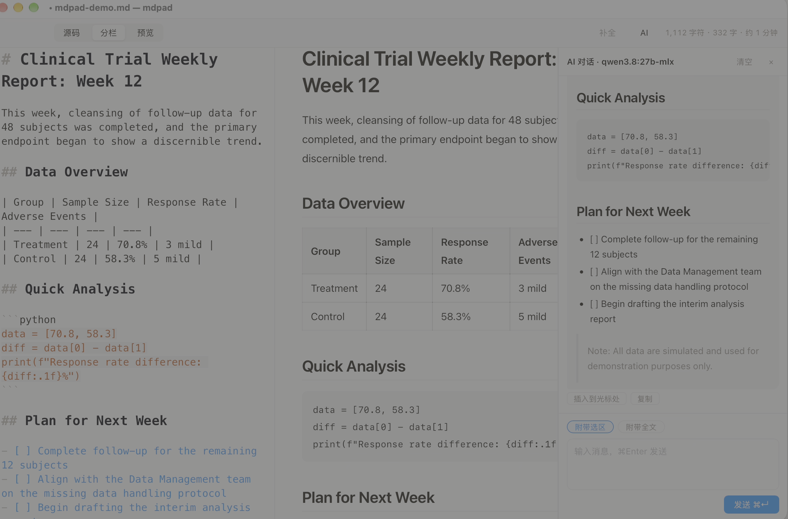

# mdpad

[中文](README.zh-CN.md) | English

A native macOS Markdown writing desk. CodeMirror 6 for editing, an AI writing assistant, locally executable code blocks, and pandoc export. The shell is Tauri 2, about 6 MB, with no bundled Chromium or Node runtime.

Current version: **1.1.1**.



## Why mdpad

mdpad is built around one loop: write, let AI help, run your code, export the result.

- Writing: CodeMirror 6, three views (source / split / preview), native macOS menus, table editing, focus mode, scroll sync
- AI: expand, summarize, or polish a selection, or chat beside the document. Local models (Ollama, LM Studio) and cloud APIs (DeepSeek, Zhipu GLM, MiniMax, Kimi, Qwen, Doubao, OpenAI) share one OpenAI-compatible client
- Code blocks: run Python, R, or Julia locally. Output and plots stay under the block. On error, AI can patch the block in place
- Ghost-text completion inside code fences (Tab to accept, Esc to dismiss)
- Export: Word and standalone HTML via pandoc, PDF via the system print dialog, one-click copy styled for the WeChat Official Account editor
- Privacy: the file stays on disk. API keys stay in the macOS Keychain. Remote images in the preview are not fetched
- Updates: signed updates from GitHub Releases (mdpad menu → 检查更新). After a crash, a banner offers to restore unsaved work

## What changed in 1.1.1

Reliability and privacy fixes. No new editing features.

- Saving a document and writing the crash snapshot both use a temp file in the same directory, `fsync`, then rename. A kill during save no longer truncates the real file
- Snapshots are queued. A save that finishes while a snapshot is still in flight cannot bring that snapshot back on the next launch
- Typing snapshots at the next 0.8 second pause, and at least every 2 seconds while you keep typing. Quitting flushes the snapshot before the unsaved-changes prompt
- A code-block timeout kills the interpreter. The UI only says the process was stopped after it has been killed. Run limit 120 seconds, syntax-check limit 30 seconds. Stdout and stderr are each capped at 256 KB
- Each run, syntax check, and export gets its own temp directory
- JPEG plots from code blocks are labeled `image/jpeg`
- AI streams reassemble UTF-8 across packets, so a Chinese character split between two chunks is not corrupted
- Chat and the writing drawer update in plain text while streaming, then render Markdown once at the end. If you scroll up, the view stays where you left it
- Ghost completion cancels when the cursor moves. Tab inserts the full suggestion that is on screen, including extra lines
- Preview keeps its scroll position across re-renders, anchored to the source line. Documents over 50,000 characters debounce to 400 ms; over 250,000 characters, to 1.5 seconds
- `https://` images in the document, chat, and AI output are not requested. The address is shown as text
- API keys are written through the Security framework, not as arguments to the `security` command. A key is sent only to the saved base URL for that provider, or to the URL you just allowed with “拉取模型列表”
- The webview has a content security policy, and the global Tauri object is not exposed

## Editing

- CodeMirror 6, incremental parsing
- Source / split / preview (⌘1 / ⌘2 / ⌘3), live render with markdown-it
- Native menus: New ⌘N, Open ⌘O, Open Recent, Save ⌘S, Save As ⇧⌘S, Close ⌘W
- Drag a `.md`, `.markdown`, `.mdown`, or `.txt` file onto the window. Find ⌘F, replace ⌥⌘F
- Word count treats CJK characters and Latin words separately. Light and dark follow the system

## Format menu

Every item toggles. Press it again to remove the mark.

- Headings 1–3 (⌃⌘1/2/3), quote, code block (⌥⌘C), horizontal rule
- Bold ⌘B, italic ⌘I, strikethrough ⇧⌘X, inline code ⇧⌘C
- Bullet, numbered, and task lists (⇧⌘7/8/9)
- Link ⌘K, image, table template (⇧⌘T), automatic footnotes
- Inside a table: hover toolbar for rows and columns. Tab moves between cells and appends a row at the end

## AI writing

Select text and a small bar appears:

- Expand: keep the voice and grow the passage to about two or three times its length
- Summarize: three to five sentences
- Polish: fix wording without changing the meaning

The result streams into a bottom drawer. You choose “替换选区” or “插入到选区后”. AI does not edit the document by itself. Reasoning models (Qwen, DeepSeek-R1, and others) can show their reasoning above the answer.

## AI chat

View → AI 对话 (⌘J) opens a side panel.

- Multi-turn, streaming, stoppable
- “附带选区 / 附带全文” chooses the context. Selection is the default. Full-document context is cut at 20,000 characters
- Each answer can be inserted at the cursor or copied
- Uses the same provider settings as the selection actions

| Kind | Providers |
| --- | --- |
| Local | Ollama, LM Studio |
| Cloud | DeepSeek, Zhipu GLM, MiniMax, Kimi, Qwen (Bailian), Doubao (Volcengine Ark), OpenAI |
| Other | Any OpenAI-compatible endpoint |

## AI code completion

Inside a fenced code block, a pause of about one second shows gray suggestion text. Tab accepts it, Esc dismisses it. The toolbar “补全” button (also in the View menu) turns it off. Completions are requested only inside fences.

If you move the cursor while a suggestion is arriving, that request is cancelled. The text Tab inserts is the text you see, including more than one line.

## Writing

- Focus mode (View → 专注模式, ⇧⌘F) dims every paragraph except the one you are in
- In split view, scrolling the editor moves the preview to the same source line. Re-rendering the preview does not jump back to the top

## Executable code blocks

Python, R, and Julia fences in the preview have “▶ 运行”, “检查”, and “✨ 解释”.

- Run uses the local interpreter. Stdout, stderr, and new `png` / `jpg` / `jpeg` / `svg` files appear under the block. Images larger than 5 MB are skipped
- The run is killed at 120 seconds. The syntax check is killed at 30 seconds and does not execute the script (`py_compile`, R `parse`, Julia `Meta.parseall`)
- If the interpreter is missing, the button shows an install hint
- “✨ 解释” explains the block in place. After a failed run, “让 AI 修复这个错误” can replace that fence in the source

Code runs as you, in a temporary directory, with no extra sandbox. Treat a fence the way you would treat a script in Terminal.

## Export

File → 导出:

- Word (`.docx`): pandoc. Math becomes editable OMML. Tables become real Word tables
- HTML: one file, inlined CSS, embedded images
- PDF: ⌘P, system print dialog. The print view is the document, not the editor chrome
- WeChat: File → 导出 → 复制为公众号格式. Paste into the Official Account editor with styling kept

`brew install pandoc` is required for Word and HTML. mdpad looks in `/opt/homebrew/bin` and `/usr/local/bin`, then on `PATH`.

## Privacy

- The file on disk is not uploaded. An AI call sends the selection, or the document text you attached (capped at 20,000 characters), plus the conversation you already started
- Remote images (`http://`, `https://`, protocol-relative) are not loaded in the preview, chat, or AI drawer
- API keys live in the macOS Keychain under the service `com.yirongcao.mdpad`. The config file stores the base URL and model name only: `~/Library/Application Support/mdpad/ai-config.json`
- A key is attached to a request only when the URL matches the saved provider URL, or the URL you just allowed by fetching the model list
- Crash snapshots, the recent-file list, and `mdpad.log` are in the same Application Support folder. The log records key length, not the key

## Install

Download the dmg from [Releases](https://github.com/erongcao/mdpad/releases) (Apple Silicon).

The app is not notarized. On first open:

- “cannot be verified” → right-click the app → Open
- “is damaged” after AirDrop or a chat app adds quarantine → `xattr -cr /Applications/mdpad.app`

To remove the app, delete it from Applications. To remove its data, also delete `~/Library/Application Support/mdpad` and the Keychain item for `com.yirongcao.mdpad`.

## Use

### Set up AI

mdpad menu → Settings (⌘,), or the AI button in the toolbar.

1. Pick a provider. Local Ollama is filled in already. Cloud providers need an API key
2. Fetch the model list, or type a model name. Doubao uses an endpoint id that starts with `ep-`
3. Save. Each provider keeps its own URL and model. Switching does not make you retype them

Fetching the model list allows that URL for this launch so the key can be sent there. Cancelling the dialog does not write the URL into the config file. The key, if you typed one, is already in the Keychain.

### Set up export

Install pandoc with `brew install pandoc`. If it is missing, export tells you so.

## Build from source

Rust and Node.js:

```bash
npm install
npm run tauri dev    # dev mode with hot reload
npm run tauri build  # release bundle in src-tauri/target/release/bundle/
```

A signed update build, when `~/.tauri/mdpad.key` is present:

```bash
scripts/release.sh 1.1.1 "notes"
```

## Tech stack

- Shell: Tauri 2 (Rust + WKWebView)
- Editor: CodeMirror 6
- Rendering: markdown-it, with raw HTML disabled
- AI: reqwest, SSE parsed in Rust. The webview only receives events
- Secrets: macOS Keychain through the Security framework (`security-framework`)

## Acknowledgements

The writing-desk shape was inspired by MDEditor (github.com/Ldxs001/maby_tool) and its derivative MDWright (github.com/zhjx19/MDWright). Ideas only. mdpad is an independent implementation.

## License

GNU AGPL-3.0-or-later. You may use, modify, and redistribute it. Redistribution, including as a network service, must stay under the same license.
