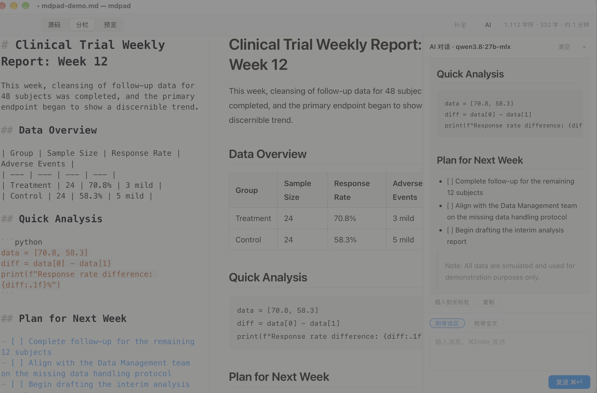

# mdpad

[中文](README.zh-CN.md) | English

A native macOS Markdown writing desk — CodeMirror 6 editor, built-in AI writing assistant, executable code blocks, and pandoc export. The whole app is about 6 MB.



## Why mdpad

Not another markdown editor. mdpad is built around a simple loop: write, let AI help, run your code, export the result.

- Writing: CodeMirror 6 core, three views (source / split / preview), native macOS menus, table editing with Tab navigation and CJK-aware alignment, focus mode, scroll sync
- AI: expand / summarize / polish a selection from a floating bar, or chat in a side panel with your document as context. Works with local models (Ollama, LM Studio) and cloud APIs (DeepSeek, Zhipu GLM, MiniMax, Kimi, Qwen, Doubao, OpenAI) — one OpenAI-compatible client covers all
- Code blocks: run python / r / julia fences locally, output and plots shown inline; on error, let AI fix the code and apply the patch back to your document in one click
- Ghost-text AI code completion inside code fences (Tab to accept), toggleable from the toolbar
- Export: Word (.docx) and standalone HTML via pandoc, PDF via system print, one-click copy styled for WeChat Official Account editor
- Privacy: documents never leave your machine; API keys live in the macOS Keychain, never in plaintext files

## Install

Download the dmg from [Releases](https://github.com/erongcao/mdpad/releases) (Apple Silicon).

The app is not notarized. On first open:

- "cannot be verified" → right-click the app icon → Open
- "is damaged" (after AirDrop / chat transfer adds quarantine) → run `xattr -cr /Applications/mdpad.app` once in Terminal

## Usage

- File menu: New ⌘N, Open ⌘O, Open Recent, Save ⌘S, Save As ⇧⌘S, Close ⌘W
- Views: source ⌘1 / split ⌘2 / preview ⌘3; AI chat panel ⌘J; focus mode ⇧⌘F
- Format menu (Bear-style, all toggles): headings ⌃⌘1-3, bold ⌘B, italic ⌘I, strikethrough ⇧⌘X, inline code ⇧⌘C, lists ⇧⌘7/8/9, link ⌘K, tables ⇧⌘T, footnotes
- Tables: hover toolbar for row/column operations; Tab jumps between cells and appends rows at the end
- AI setup: mdpad menu → Settings (⌘,), pick a provider, paste the key, fetch the model list

## Build from source

Requires Rust and Node.js:

```bash
npm install
npm run tauri dev    # dev mode with hot reload
npm run tauri build  # release bundle in src-tauri/target/release/bundle/
```

## Tech stack

- Shell: Tauri 2 (Rust + WKWebView) — no Electron, no bundled Chromium or Node runtime
- Editor: CodeMirror 6; rendering: markdown-it
- AI: reqwest + SSE streaming in Rust, frontend receives events
- Secrets: macOS Keychain via the security CLI

## Acknowledgements

The writing-desk product shape was inspired by MDEditor (github.com/Ldxs001/maby_tool) and its derivative MDWright (github.com/zhjx19/MDWright) — ideas only, mdpad is an independent implementation.

## License

GNU AGPL-3.0-or-later.
