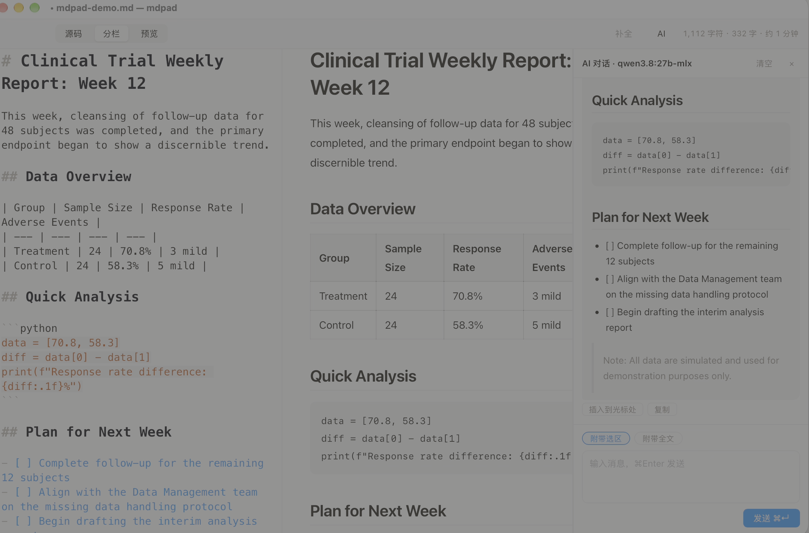

# mdpad

[English](README.md) | 中文

macOS 上的 Markdown 写作台：CodeMirror 6 编辑、AI 辅助、本地可运行的代码块、pandoc 导出。外壳是 Tauri 2，大约 6 MB，不带 Chromium，也不带 Node 运行时。

当前版本：**1.1.2**。



## 它解决什么

写一段，让 AI 帮忙，把代码跑一下，再导出。这条链路是这个应用的全部。

- 写作：CodeMirror 6，源码 / 分栏 / 预览，原生菜单，表格编辑，专注模式，滚动同步
- AI：选区扩写、总结、润色，或在侧栏对话。本地模型（Ollama、LM Studio）和云端（DeepSeek、智谱 GLM、MiniMax、Kimi、通义千问、豆包、OpenAI）走同一套 OpenAI 兼容协议
- 代码块：本地跑 Python、R、Julia。输出和图留在代码块下面。报错后可以让 AI 把修正写回原文
- 代码块内的灰色补全（Tab 接受，Esc 丢掉）
- 导出：pandoc 出 Word 和单文件 HTML，系统打印出 PDF，一键复制成公众号排版
- 隐私：文件留在磁盘上。API Key 在 macOS 钥匙串里。预览显示文稿旁边的本地图片，远程图片不会去拉取
- 更新：签名包从 GitHub Releases 下来（mdpad 菜单 → 检查更新）。崩溃后重开会问要不要恢复未保存的修改

## 1.1.2 改了什么

- 崩溃恢复横幅还在时，打开别的文件、新建、继续打字，都不会盖掉或删掉那份快照。点「恢复」才载入，点「丢弃」才删除。丢弃之后，当前稿子如果已经改过，会接着记快照
- 预览按文稿所在目录显示本地图片，包括相对路径、绝对路径和 `file://`。图片读入后以 data URI 显示。找不到、超过 15 MB，或文稿还没保存，只显示路径
- 在编辑器里粘贴截图，或把 png、jpg、gif、webp、svg 拖进窗口，图片存到文稿旁边并插入 ``。文件本来就在文稿目录里时，只插入相对路径
- 格式菜单里的「图片」仍插入 `` 占位。把文件放进文稿，用粘贴或拖入

## 1.1.1 改了什么

这一版是可靠性和隐私修复，没有新的写作功能。

- 保存正文和写崩溃快照都是同目录临时文件、`fsync`、再改名。保存写到一半被杀掉，不会把原文件截成空文件
- 快照的写入和删除排成一队。保存完成时如果还有一次快照在飞，那次写入不会在下次启动时把已保存的稿子又提示恢复
- 停手 0.8 秒落一次快照；连续打字最多 2 秒也落一次。退出时先把快照刷完，再问要不要丢掉未保存的修改
- 代码块超时会真的杀掉解释器，界面上的「已终止」发生在进程被杀掉之后。运行上限 120 秒，语法检查上限 30 秒。标准输出和标准错误各自最多保留 256 KB
- 每次运行、语法检查、导出都用自己的临时目录
- 代码块生成的 JPEG 按 `image/jpeg` 显示
- AI 流按 UTF-8 字符边界拼接。一个汉字被拆进两个网络包时，不再变成乱码
- 对话和润色抽屉在生成过程中只更新纯文本，结束后再渲染一次 Markdown。你已经往上翻时，滚动条不会被拽回去
- 幽灵补全会在光标挪走时取消。Tab 插入的就是屏幕上看到的全部文字，包括多行
- 预览重绘后按源码行号留在原处。文档超过 5 万字，预览防抖改为 400 毫秒；超过 25 万字，改为 1.5 秒
- 文档、对话和 AI 结果里的 `https://` 图片不会发请求，只显示地址
- API Key 经 Security 框架写入钥匙串，不再作为 `security` 命令的参数。密钥只发给该服务商已保存的接口地址，或你刚刚用「拉取模型列表」放行的那个地址
- WebView 有内容安全策略，不再把全局 Tauri 对象挂到 `window` 上

## 编辑

- CodeMirror 6，增量解析
- 源码 / 分栏 / 预览（⌘1 / ⌘2 / ⌘3），markdown-it 实时渲染
- 原生菜单：新建 ⌘N、打开 ⌘O、打开最近、保存 ⌘S、另存为 ⇧⌘S、关闭窗口 ⌘W
- 把 `.md`、`.markdown`、`.mdown`、`.txt` 拖进窗口。查找 ⌘F，替换 ⌥⌘F
- 字数把中文字符和西文单词分开计。深浅色跟随系统

## 格式菜单

全部是开关：再按一次就去掉。

- 标题 1–3（⌃⌘1/2/3）、引用、代码块（⌥⌘C）、分隔线
- 加粗 ⌘B、斜体 ⌘I、删除线 ⇧⌘X、行内代码 ⇧⌘C
- 无序 / 有序 / 任务列表（⇧⌘7/8/9）
- 链接 ⌘K、图片占位、表格模板（⇧⌘T）、自动编号脚注。粘贴或拖入图片会存到文稿旁边
- 在表格里：悬停工具条增删行列。Tab 在单元格之间移动，到末尾会补一行

## AI 辅助写作

选中一段文字，浮出小条：

- 扩写：保持语气，把篇幅扩到大约两三倍
- 总结：三到五句话
- 润色：改语病，不改原意

结果流式进底部抽屉。你自己选「替换选区」或「插入到选区后」。AI 不会直接改原文。推理模型（Qwen、DeepSeek-R1 等）可以把思考过程显示在回答上面。

## AI 对话

视图 ▸ AI 对话（⌘J）打开右侧面板。

- 多轮、流式、可以停
- 「附带选区 / 附带全文」决定上下文。默认只发选区。全文最多带 2 万字，多出来的会截断
- 每条回答可以插入到光标处，或复制
- 和服务商设置是同一份

| 类型 | 服务商 |
| --- | --- |
| 本地 | Ollama、LM Studio |
| 云端 | DeepSeek、智谱 GLM、MiniMax、Kimi（月之暗面）、通义千问（百炼）、豆包（火山方舟）、OpenAI |
| 其他 | 任何 OpenAI 兼容端点 |

## AI 代码补全

在代码围栏里停大约一秒，会出现灰色建议。Tab 接受，Esc 丢掉。工具栏「补全」按钮可以关掉，视图菜单里也有。正文里不会触发。

建议还在飞的时候如果光标挪走，这次请求会取消。Tab 插入的就是你看见的那些字，不止第一行。

## 写作体验

- 专注模式（视图 ▸ 专注模式，⇧⌘F）：只留下当前段落，其余变淡
- 分栏时，编辑区滚动会把预览对到同一源码行。预览重绘不会跳回顶部

## 可执行代码块

预览里的 Python、R、Julia 围栏有「▶ 运行」「检查」「✨ 解释」。

- 运行走本机解释器。标准输出、标准错误，以及新生成的 `png` / `jpg` / `jpeg` / `svg` 显示在代码块下面。超过 5 MB 的图会跳过
- 运行到 120 秒会被杀掉。语法检查到 30 秒会被杀掉，而且不执行脚本（`py_compile`、R 的 `parse`、Julia 的 `Meta.parseall`）
- 找不到解释器时，按钮上有安装提示
- 「✨ 解释」就地讲解。运行失败后，「让 AI 修复这个错误」可以把修正写回源码里的那一个围栏

代码以你的用户身份跑，工作目录是临时文件夹，没有额外沙箱。把它当成在终端里执行的脚本。

## 导出

文件 ▸ 导出：

- Word（`.docx`）：pandoc。公式变成可编辑的 OMML，表格是真 Word 表格
- HTML：单个文件，样式内联，图片内嵌
- PDF：⌘P 系统打印。打印的是正文，不是编辑器外壳
- 公众号：文件 ▸ 导出 ▸ 复制为公众号格式。粘贴进公众号编辑器时排版还在

Word 和 HTML 需要 `brew install pandoc`。程序会找 `/opt/homebrew/bin`、`/usr/local/bin`，再找 `PATH`。

## 隐私

- 磁盘上的文件不会被上传。AI 请求只带你选中的文字，或你打开的全文（最多 2 万字），加上你已经发出去的对话
- 预览显示文稿目录里的本地图片。对话和 AI 抽屉，以及预览里的远程图片（`http://`、`https://`、协议相对地址）不发请求，只显示 URL
- API Key 在 macOS 钥匙串，服务名 `com.yirongcao.mdpad`。配置文件只存接口地址和模型名：`~/Library/Application Support/mdpad/ai-config.json`
- 密钥只在请求地址等于该服务商已保存的地址时附上，或者等于你刚刚点「拉取模型列表」放行的地址
- 崩溃快照、最近文件和 `mdpad.log` 也在这个 Application Support 目录里。日志记密钥长度，不记密钥本身

## 安装

从 [Releases](https://github.com/erongcao/mdpad/releases) 下载 dmg（Apple 芯片）。

应用没有公证。第一次打开：

- 「无法验证开发者」：右键应用 → 打开
- 经过 AirDrop 或聊天软件后提示「已损坏」：终端执行 `xattr -cr /Applications/mdpad.app`

卸载时把应用从「应用程序」删掉。数据还在的话，再删 `~/Library/Application Support/mdpad`，并在钥匙串里删掉 `com.yirongcao.mdpad`。

## 使用

### 配置 AI

mdpad 菜单 → 设置（⌘,），或工具栏上的 AI 按钮。

1. 选服务商。本地 Ollama 已经填了地址。云端要填 API Key
2. 拉取模型列表，或自己填模型名。豆包填的是 `ep-` 开头的接入点 ID
3. 保存。每个服务商的地址和模型分开记，切换不用重输

拉取模型列表会在本次启动里放行那个地址，密钥才能发过去。取消设置不会把地址写进配置文件。如果你已经输入了 Key，它此时已经在钥匙串里。

### 配置导出

`brew install pandoc`。没装时，导出会直接告诉你。

## 从源码构建

需要 Rust 和 Node.js：

```bash
npm install
npm run tauri dev    # 开发模式，热更新
npm run tauri build  # 打包，产物在 src-tauri/target/release/bundle/
```

有 `~/.tauri/mdpad.key` 时，可以打签名更新包：

```bash
scripts/release.sh 1.1.2 "说明"
```

## 技术栈

- 外壳：Tauri 2（Rust + WKWebView）
- 编辑器：CodeMirror 6
- 渲染：markdown-it，关闭原始 HTML
- AI：reqwest，SSE 在 Rust 里解析。WebView 只收事件
- 密钥：macOS 钥匙串，经 Security 框架（`security-framework`）

## 致谢

写作台的产品形态参考了 MDEditor（github.com/Ldxs001/maby_tool）和衍生项目墨匠 MDWright（github.com/zhjx19/MDWright）。只借鉴思路，代码是独立实现。

## License

GNU AGPL-3.0-or-later。可以使用、修改、再分发。再分发（包括以网络服务的形式提供）必须继续用同一协议。
